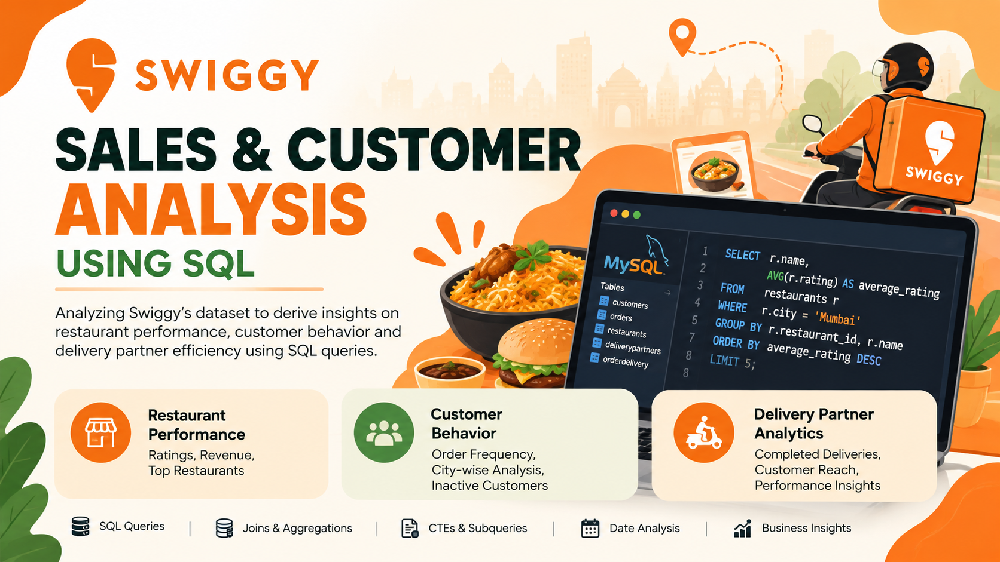
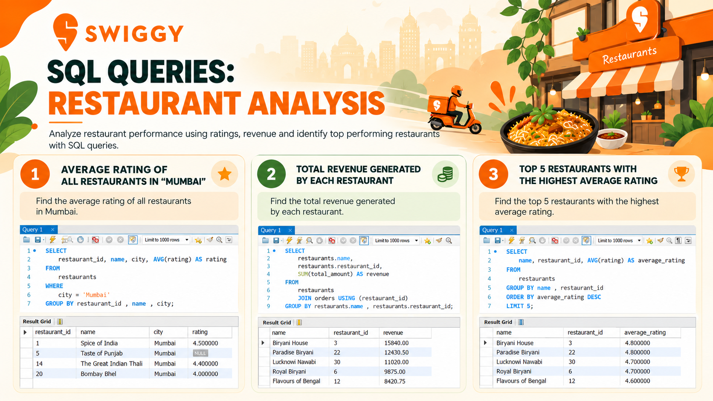
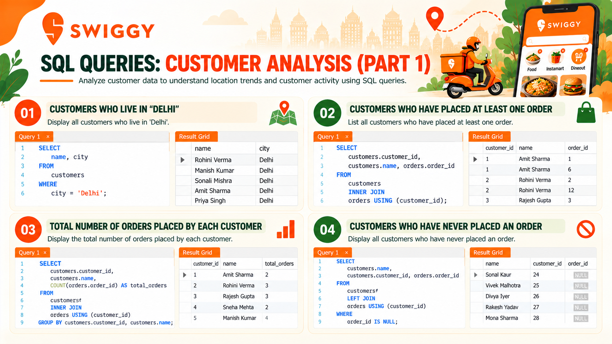
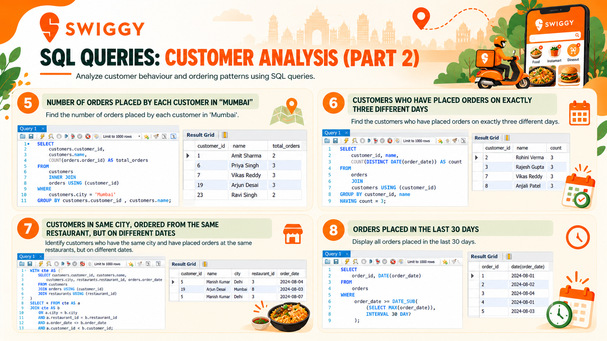
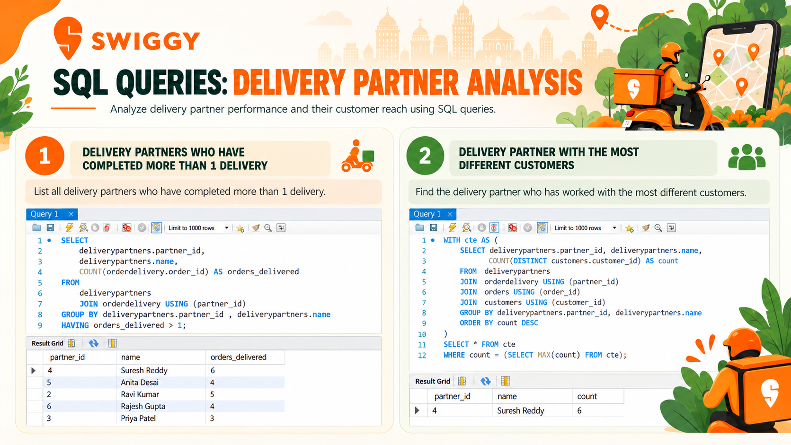

# 🍜 Swiggy SQL Case Study
### Restaurant Performance | Customer Behavior | Delivery Partner Analytics

An SQL-based business analytics project exploring restaurant performance, customer ordering patterns, and delivery partner activity using MySQL.

[📊 View Presentation](Swiggy_SQL_Case_Study.pdf) · [💻 Explore SQL Queries](swiggy_analysis.sql)

---

## 📌 Project Overview

How can SQL help a food-delivery business understand restaurant performance, customer behavior, and delivery operations?

This project uses a Swiggy-inspired relational dataset to answer 13 business questions using MySQL. The analysis applies joins, aggregations, date functions, subqueries, and Common Table Expressions (CTEs) to examine business activity and identify potential areas for further investigation.

## 🖼️ Project Preview

## 🎯 Business Objectives

- 🍴 **Restaurant Performance:** Analyze restaurant ratings and revenue.
- 👥 **Customer Behavior:** Examine order frequency, customer activity, and ordering patterns.
- 🛵 **Delivery Operations:** Evaluate delivery partner activity and distinct customers served.
- 📊 **Business Insights:** Translate query results into potential business recommendations.

## 🛠️ Tools & SQL Concepts

| Tool / Concept | Application |
|---|---|
| MySQL | Querying relational data |
| `SELECT`, `WHERE` | Retrieving and filtering records |
| `JOIN` | Combining related tables |
| Aggregate functions | Calculating counts, revenue, and average ratings |
| `GROUP BY`, `HAVING` | Summarizing and filtering grouped data |
| Subqueries | Solving multi-step analytical questions |
| CTEs | Organizing complex query logic |
| Date functions | Analyzing order dates and ordering days |
| `COUNT(DISTINCT ...)` | Counting unique customers and dates |

## 🔍 Business Questions

### 🍴 Restaurant Analysis

1. What is the average restaurant rating in Mumbai?
2. Which five restaurants have the highest average ratings?
3. What is the total revenue generated by each restaurant?

### 👥 Customer Analysis

4. Which customers live in Delhi?
5. Which customers have placed at least one order?
6. How many orders has each customer placed?
7. Which customers have never placed an order?
8. How many orders have customers in Mumbai placed?
9. Which orders fall within the last 30 days relative to the latest order date in the dataset?
10. Which customers placed orders on exactly three distinct days?
11. Which customers in the same city ordered from the same restaurant on different dates?

### 🛵 Delivery Partner Analysis

12. Which delivery partners have more than one recorded delivery?
13. Which delivery partner served the highest number of distinct customers?

## 📸 SQL Analysis Screenshots

### 🍴 Restaurant Analysis

### 👥 Customer Analysis — Part 1

### 👥 Customer Analysis — Part 2

### 🛵 Delivery Partner Analysis

## 💻 SQL Implementation

The complete SQL script contains queries addressing the project's business questions.

**SQL file:** [`swiggy_analysis.sql`](swiggy_analysis.sql)

The queries demonstrate how SQL can be used to retrieve, combine, aggregate, and analyze relational data to answer practical business questions.

## 📈 Potential Business Applications

- **Restaurant performance:** Investigate differences in ratings and revenue.
- **Customer engagement:** Examine ordering frequency and identify customers with no recorded orders.
- **Repeat ordering:** Use customer ordering patterns to identify opportunities for further retention analysis.
- **Delivery operations:** Examine delivery partner activity and customer coverage.

These are potential applications of the analysis. Any conclusions or recommendations should be validated against the actual query outputs and dataset.

## 🧠 Key Learnings

- Translating business questions into SQL queries.
- Joining related tables for multi-table analysis.
- Using aggregation to summarize business activity.
- Applying CTEs, subqueries, and date functions.
- Communicating analytical work through screenshots and a structured presentation.

## 📑 Project Presentation

Explore the full case study presentation.

**PDF file:** [`Swiggy_SQL_Case_Study.pdf`](Swiggy_SQL_Case_Study.pdf)

## 👤 Author

**Rohit Nair**

Business Analytics | SQL | Data-Driven Problem Solving

---
